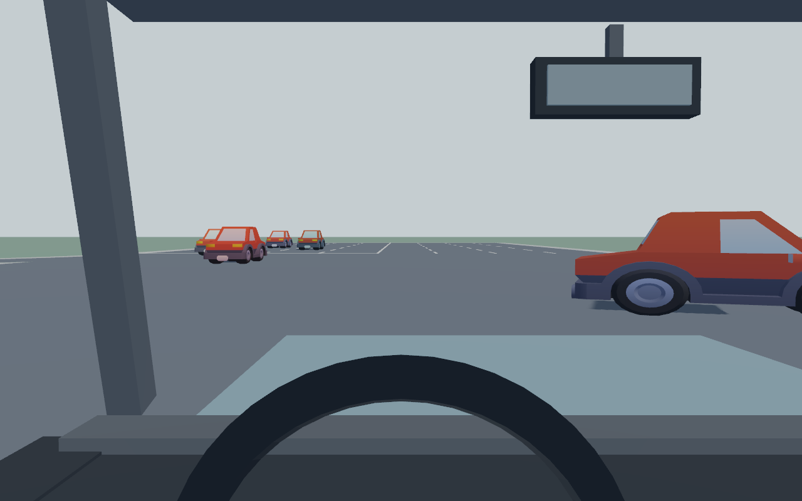

О математическом моделировании движения автомобилей на перекрёстке
Разрабатывается математическая модель водителя на перекрестке на основе реально доступной информации с продольно-поперечной динамикой. Опираюсь на следующие результаты.

### Andersen и Sauer — управление по зрительной информации

В работе *Optical Information for Car Following* авторы предложили модель Driving by Visual Angle, DVA. Она описывает ускорение следующего автомобиля через зрительный угол лидера и скорость изменения этого угла

$$
a(t)=j\left(\frac{1}{\alpha(t)}-\frac{1}{\alpha^*}\right)
+k\dot\alpha(t).
$$

Здесь $\alpha$ — угловая ширина изображения лидера, $\alpha^*$ — желаемый угол, $j$ и $k$ — коэффициенты. Первый член поддерживает дистанцию. Второй реагирует на расширение или сжатие изображения. При сближении угол растёт, а отрицательное $k$ даёт тормозящий вклад.

Авторы проверили DVA в двух экспериментах на симуляторе и на шести эпизодах реального движения. Модель воспроизводила существенные особенности реакции водителей, включая задержки и избыточные коррекции. В сравнении с AIMSUN ряд показателей оказался ближе к человеческому поведению. Для моей задачи важен сам результат — оптические переменные могут служить входом модели управления автомобилем. [Andersen & Sauer, 2007](https://doi.org/10.1518/001872007X230235)

### Zgonnikov, Abbink и Markkula — накопление свидетельств для принятия интервала

Авторы исследовали левый поворот перед встречной машиной. С увеличением начального расстояния и времени до её прибытия участники чаще выбирали проезд. При большем времени до прибытия ответ «ехать» в среднем возникал позже.

Для объяснения результатов авторы предложили обобщённую дрейф-диффузионную модель накопления свидетельств

$$
dx(t)=\alpha_D\left[TTA(t)+\beta d(t)-\theta_{\mathrm{crit}}\right]dt+dW(t).
$$

Здесь $x$ — переменная решения, $d$ — расстояние до встречной машины, $TTA$ — время до её прибытия, а $W$ — винеровский процесс. Расстояние и $TTA$ обновляются, пока водитель решает. При приближении машины границы решения сближаются, отражая возрастающую срочность.
Модель описала выбор и распределения времени ответа. Перекрёстная проверка показала перенос на исключённые условия эксперимента (в статье исключали одно из условие из девяти используемых и проверяли модель на восьми полученных условиях).  [Zgonnikov, Abbink & Markkula, 2024](https://doi.org/10.1177/00187208221144561)

Основная гипотеза для обобщения данного результата состоит в том, что, ожидая возможности маневра при левом повороте через встречный поток, водитель способен к анализу не только одного интервала (пространственно-временного промежутка между текущей машиной и наблюдаемой машиной), но и интервалов, образованных машинами во встречном потоке. Еще до окончательного принятия решения о повороте водитель оценивает пригодность тех или иных интервалов, иначе говоря, накапливает свидетельства. Эти свидетельства можно описать дрейф-диффузионной моделью DDM, только, скорее всего, с другой составляющей дрейфа. Также есть гипотеза о том, что модель управления по зрительной информации Андерсена и Зауэра способна к обобщению со случая продольной динамики на случай продольно-поперечной динамики (как езда прямо, так и повороты налево/направо).

Для данной модели готовится фреймворк на языке Python, который позволит явно моделировать зрительный вход водителя и использовать его в сценариях как в ситуации следования за лидером, так и в одной из самых когнитивно сложных ситуаций --- незащищенного левого поворота через встречный поток.

Обзорный доклад по данной теме представлен на спецсеминаре моей кафедры системного анализа:
https://github.com/Supremum1/driver-model/blob/main/presentation.pdf

## Литература

1. Andersen, G. J., & Sauer, C. W. (2007). *Optical Information for Car Following: The Driving by Visual Angle (DVA) Model*. Human Factors, 49(5), 878–896. [Статья](https://doi.org/10.1518/001872007X230235).
2. Zgonnikov, A., Abbink, D., & Markkula, G. (2024). *Should I Stay or Should I Go? Cognitive Modeling of Left-Turn Gap Acceptance Decisions in Human Drivers*. Human Factors, 66(5), 1399–1413. Онлайн-публикация 2022 года. [Статья](https://doi.org/10.1177/00187208221144561).
